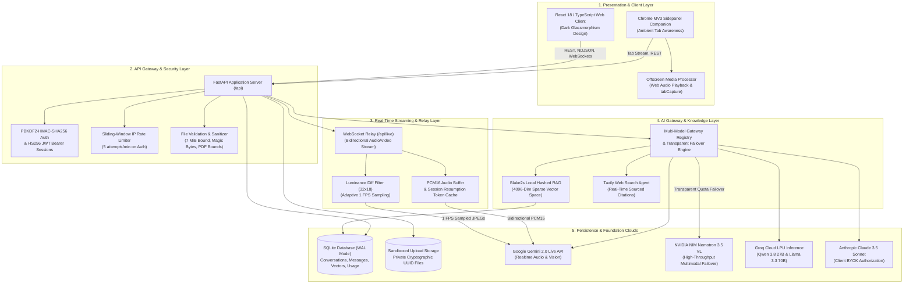

# OmniAssist: AI-Powered Multimodal Interactive Assistant

[](LICENSE)
[](https://www.python.org/)
[](https://fastapi.tiangolo.com/)
[](https://react.dev/)
[](https://www.typescriptlang.org/)
[](https://tailwindcss.com/)
[](https://developer.chrome.com/docs/extensions/mv3/)

> **OmniAssist** is an intelligent, privacy-preserving multimodal assistant platform featuring real-time visual screen perception, bidirectional continuous voice streaming, local-first document retrieval (RAG), and resilient multi-model AI orchestration. 

Built with a dual-surface presentation layer—a responsive **Glassmorphism Web Workspace** and an ambient **Google Chrome Manifest V3 Sidepanel Companion**—OmniAssist allows users to collaborate with advanced foundation models without manual screenshot taking, window switching, or copy-pasting.

---

## Table of Contents
1. [What, Why, and How](#what-why-and-how)
2. [Key Capabilities & Features](#key-capabilities--features)
3. [System Architecture & Dataflow](#system-architecture--dataflow)
4. [Tech Stack & Justifications](#tech-stack--justifications)
5. [Database Schema & Procedures](#database-schema--procedures)
6. [Security & Privacy Guardrails](#security--privacy-guardrails)
7. [AI Model Connections & Fault-Tolerant Routing](#ai-model-connections--fault-tolerant-routing)
8. [Installation & Setup Guide](#installation--setup-guide)
9. [API & WebSocket Protocol Reference](#api--websocket-protocol-reference)
10. [Chrome Extension Setup](#chrome-extension-setup)
11. [Academic Documentation & Team Details](#academic-documentation--team-details)

---

## What, Why, and How

### What is OmniAssist?
OmniAssist is an end-to-end multimodal assistant system that provides continuous visual perception of the user's active screen, natural conversational audio dialogue, private document comprehension, and human-in-the-loop web automation.

### Why was it built?
Traditional conversational AI platforms suffer from five critical limitations:
1. **Visual Disconnection:** Existing AI chats operate in isolated browser tabs disconnected from the user's active desktop environment. Users must manually capture, save, and attach static screenshots.
2. **Turn-Based Conversational Latency:** Traditional request-response pipelines require sequential text transcription, inference, and text-to-speech, preventing spontaneous conversational interruptions or natural back-and-forth dialogue.
3. **Fragile Provider Lock-In & Billing Cliffs:** Tying an application to a single AI provider causes complete operational failure when that provider experiences rate limits (HTTP 429), downtime, or credit balance exhaustion ($0 balances).
4. **Data Sovereignty & Document Leakage:** Conventional Retrieval-Augmented Generation (RAG) frameworks send proprietary source code, internal research PDFs, and sensitive notes to third-party embedding models and cloud vector databases.
5. **Passive Dialogue vs Active Digital Automation:** Chatbots generate descriptive text but cannot interact directly with the user's active browsing session.

### How does it work?
- **Real-Time Visual Perception:** Captures display feeds via WebRTC (`getDisplayMedia` / `tabCapture`), processes frames through a 32x18 normalized luminance difference filter, and streams adaptive JPEG frames (capped at 1 FPS with a 15-second refresh) over WebSockets.
- **Sub-Second Voice Streaming:** Relays bidirectional 16-bit linear PCM audio to Google's Gemini Live API via an authenticated backend WebSocket relay.
- **Resilient Multi-Model Orchestration:** Dispatches queries across Google Gemini, NVIDIA NIM (Nemotron 3.5 Super VL), Groq LPUs, and OpenRouter, supporting Bring-Your-Own-Key (BYOK) Anthropic Claude and transparent automatic failover when primary models hit quota limits.
- **Zero-Leakage Local RAG:** Extracts text from PDFs and source code, segments it into overlapping chunks, and indexes it into a 4096-dimensional sparse lexical vector space using Blake2s hashing stored directly in SQLite WAL mode.
- **Human-in-the-Loop Browser Automation:** Proposes structured browser actions (navigation, form filling, text copying) that require explicit user approval before execution by the Chrome Extension.

---

## Key Capabilities & Features

- **Adaptive Screen Perception (1 FPS Max):** High-speed perceptual filter downscales video to a 32x18 luminance grid. Duplicate frames are suppressed at zero bandwidth, while screen updates trigger immediate 1 FPS JPEG observation frames.
- **Full-Duplex Gemini Live Audio:** Sub-second voice conversation with session resumption, context compression, and automatic reconnection across transient connection drops.
- **Transparent Quota Failover:** When OpenAI accounts encounter quota exhaustion (HTTP 429 or $0 credit balance), OmniAssist intercepts the error and automatically routes the request to NVIDIA Nemotron 3.5 Super VL without dropping user dialogue.
- **Bring-Your-Own-Key (BYOK) Support:** Users can supply their Anthropic API key directly in client settings. Keys remain in local browser memory and are injected via request headers, never saved in the database.
- **Local Hashed-Vector RAG Engine:** Indexes PDFs and source code using Blake2s cryptographic hashing into 4096 feature buckets in SQLite. Zero cloud embedding API costs, zero data leakage.
- **Ambient Chrome Sidepanel Companion (MV3):** Read current page content, explain highlighted selections, capture visible tab screenshots, and run continuous tab audio/video assistance via `tabCapture` and offscreen Web Audio documents.
- **Human-in-the-Loop Action Execution:** Model-proposed browser actions (open URL, web search, scroll, fill field, copy text) are staged in a `pending` state and executed only after explicit user verification.
- **Token & Cost Accounting Dashboard:** Real-time tracking of daily request limits, input/output token counts, cached tokens, and estimated USD expenditure based on operator rate tables.

---

## System Architecture & Dataflow



---

## Tech Stack & Justifications

| Component | Technology | Technical Justification |
| :--- | :--- | :--- |
| **Backend Framework** | **FastAPI (Python 3.10+)** | High-performance asynchronous runtime; native support for NDJSON streaming, Server-Sent Events (SSE), and WebSockets; direct access to `pypdf`, `Pillow`, and `hashlib`. |
| **Frontend Framework** | **React 18 + TypeScript + Vite** | Concurrent React 18 rendering guarantees non-blocking markdown updates during high-throughput token streaming; Vite provides sub-second HMR. |
| **UI Styling** | **Tailwind CSS (Custom Glass Tokens)** | Composable backdrop-filter blurs, ambient glow gradients, and responsive layouts matching premium dark glassmorphism standards. |
| **Database Engine** | **SQLite 3 (WAL Mode)** | Local-first, zero-maintenance, zero-network-latency embedded database. Write-Ahead Logging allows concurrent reads during write transactions. |
| **Document Retrieval** | **Blake2s Sparse Hashed Vectors (4096-dim)** | Dependency-free mathematical representation eliminating external embedding API fees and preserving 100% document confidentiality. |
| **Audio-Visual Protocols** | **WebRTC & WebSockets** | Sub-100ms full-duplex PCM audio streaming and frame transmission directly between browser sandboxes and backend relays. |
| **Browser Extension** | **Chrome Manifest V3** | Runs within the user's existing browser runtime at zero additional memory overhead; accesses active tabs via native extension APIs. |

---

## Database Schema & Procedures

OmniAssist utilizes SQLite with Write-Ahead Logging (`PRAGMA journal_mode = WAL`) and strict foreign key integrity (`PRAGMA foreign_keys = ON`).

### Key Database Tables
- `users`: User identity, email (NOCASE unique), PBKDF2-HMAC-SHA256 password hash, memory toggle status.
- `auth_rate_limits`: Sliding-window client IP rate limiter (records attempt timestamps, enforces 5 attempts/minute).
- `conversations`: Conversation sessions, user ownership (`owner_id`), title, compact context summary, and timestamps.
- `messages`: Dialogue turns, role (`user` / `assistant`), text content, model identifier, attachment references, and source citation URLs.
- `files`: Uploaded document metadata, MIME type, file size, extracted text, and conversation reference.
- `file_chunks`: Segmented text chunks (1100 chars, 150 overlap) with JSON-serialized Blake2s 4096-dimensional sparse vectors.
- `memories`: User-authored explicit persistent facts injected into model system prompts when enabled.
- `actions`: Model-proposed browser operations, action type, JSON payload, approval status (`pending`, `approved`, `rejected`), and execution results.
- `model_usage_events`: Detailed accounting ledger storing input tokens, output tokens, cached tokens, and estimated USD cost per model call.

---

## Security & Privacy Guardrails

- **Password Security:** PBKDF2-HMAC-SHA256 with 310,000 iterations and 16-byte random salt. Constant-time verification using `hmac.compare_digest` with dummy hash execution for non-existent users.
- **Session Authentication:** HS256-signed JWT bearer tokens with 12-hour expiration. Ephemeral random secret fallback if unconfigured.
- **File Validation & Image-Bomb Defense:** Extension allowlists, magic byte verification (`%PDF-`, PNG/JPEG signatures), 7 MiB file size limits, and 100-page PDF limits. Sanitized filenames strip path traversal sequences (`../`).
- **Origin & CORS Regulation:** Strictly regex-bounded CORS policy allowing localhost, local subnet IP addresses, and `chrome-extension://[a-p]{32}`.
- **Action Allowlist:** Browser actions restricted to non-destructive tasks (`navigate`, `web_search`, `copy_text`, `scroll`, `fill_field`). Execution requires explicit user approval.

---

## AI Model Connections & Fault-Tolerant Routing

OmniAssist connects to a diverse array of foundation models through its unified gateway:

```
[User Chat Request]
        │
        ├─► Google Gemini (gemini-flash-lite-latest, Gemini 2.0 Live)
        ├─► NVIDIA NIM (Nemotron 3.5 Super VL 120B)
        ├─► Groq LPU (Qwen 3.8 27B, Llama 3.3 70B Versatile)
        ├─► OpenRouter (Nemotron 3.5 Super VL Free Tier)
        ├─► Anthropic Claude 3.5 (Client BYOK API Key)
        └─► OpenAI API (gpt-4o-mini)
                 │
                 └─► [On 429 Quota Exhaustion / $0 Balance]
                           │
                           ▼
                     [Automatic Transparent Failover to Nemotron 3.5 Super VL]
```

---

## Installation & Setup Guide

### 1. Prerequisites
- **Python:** 3.10 or 3.11 installed and available in PATH.
- **Node.js:** v18.0+ and npm installed.
- **Google Chrome:** Version 116 or newer (for Manifest V3 sidepanel support).

### 2. Backend Setup
```powershell
# Navigate to backend directory
cd backend

# Create virtual environment
python -m venv .venv
.venv\Scripts\Activate.ps1

# Install dependencies
pip install -r requirements.txt

# Configure environment variables
Copy-Item .env.example .env
# Edit backend/.env and populate your API keys (GEMINI_API_KEY, NVIDIA_API_KEY, GROQ_API_KEY, etc.)

# Start FastAPI backend server
uvicorn app.main:app --reload --port 8000
```
Backend API documentation will be accessible at: `http://localhost:8000/docs`

### 3. Web Client Setup
```powershell
# Navigate to web workspace
cd apps/web

# Install frontend dependencies
npm install

# Start Vite development server
npm run dev
```
Open your browser and navigate to: `http://localhost:5173`

---

## API & WebSocket Protocol Reference

- `POST /api/auth/register`: Create a new user account.
- `POST /api/auth/login`: Authenticate and receive an HS256 JWT bearer token.
- `GET /api/auth/me`: Retrieve active user profile and memory preferences.
- `GET /api/models`: List configured foundation models and capability flags.
- `GET /api/conversations`: List user conversations with case-insensitive search (`?q=query`).
- `POST /api/chat/stream`: Stream conversation turns as progressive NDJSON chunks.
- `POST /api/files`: Upload and index private documents into the local RAG engine.
- `GET /api/usage`: Retrieve UTC request totals, token counts, and cost estimates.
- `WS /api/live`: Real-time bidirectional WebSocket relay for Gemini Live audio/video streaming.

---

## Chrome Extension Setup

1. Open Google Chrome and navigate to `chrome://extensions/`.
2. Enable **Developer mode** using the toggle switch in the upper-right corner.
3. Click **Load unpacked** and select the folder: `c:\Projects\OmniAssist\apps\extension`.
4. Click the extension puzzle icon in the Chrome toolbar and pin **OmniAssist Companion**.
5. Click the extension icon to open the **Side Panel**. Log in with your OmniAssist account credentials.
6. Use **Read page**, **Explain selection**, or **Start tab live** to collaborate seamlessly across any web page!

---

## Academic Documentation & Team Details

This project is submitted in partial fulfillment of the requirements for the award of the degree of **Bachelor of Technology in Computer Science and Engineering (Data Science)** at **MLR Institute of Technology (UGC Autonomous)**, Hyderabad.

### Project Team (Batch-A3):
- **BUDDEPU NAGAMANI** (Roll No: `23R21A6709`)
- **KANAPARTHI ASEERVADHAM** (Roll No: `24R25A6704`)
- **CHALLAWAR SAI CHARAN** (Roll No: `24R25A6701`)

### Project Guide:
- **Dr. V. SRAVAN KUMAR**, Assistant Professor, Dept. of CSE (Data Science), MLRIT.

### Project Head & Principal:
- **Dr. SRIDHAR MOURYA**, Professor & Head, Department of CSE (Data Science), MLRIT.
- **Dr. S. V. S. PRASAD**, Principal, MLR Institute of Technology.

*Academic documentation deliverables strictly conforming to MLRIT guidelines (Phase-II / Till Design Phase) are available in:*
`documentation/final_report/`
- `OmniAssist_Project_Report.docx` (Complete academic Word report)
- `OmniAssist_Project_Report.pdf` (Complete academic PDF report)
- `OmniAssist_Project_Report.md` (Complete academic Markdown report)
- `reference_template_analysis.md` (Template analysis and institutional mapping)
- `diagrams/` (Source PlantUML and Mermaid files for all 21 system architecture and module diagrams)
