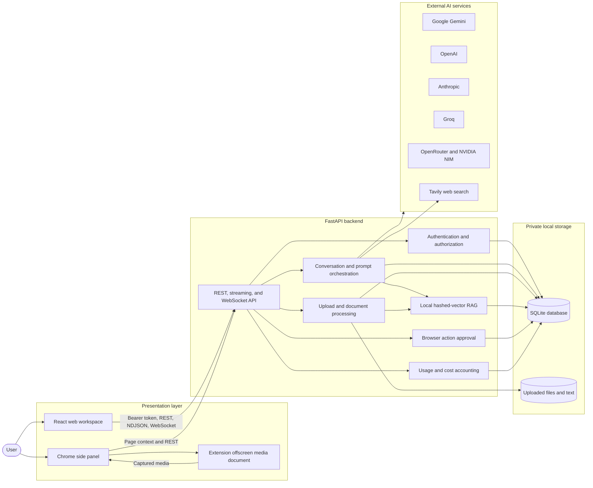
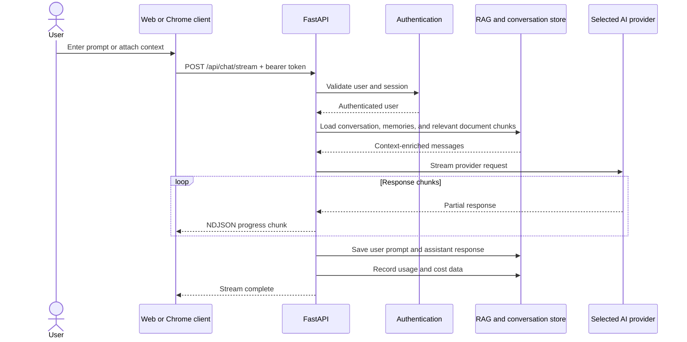
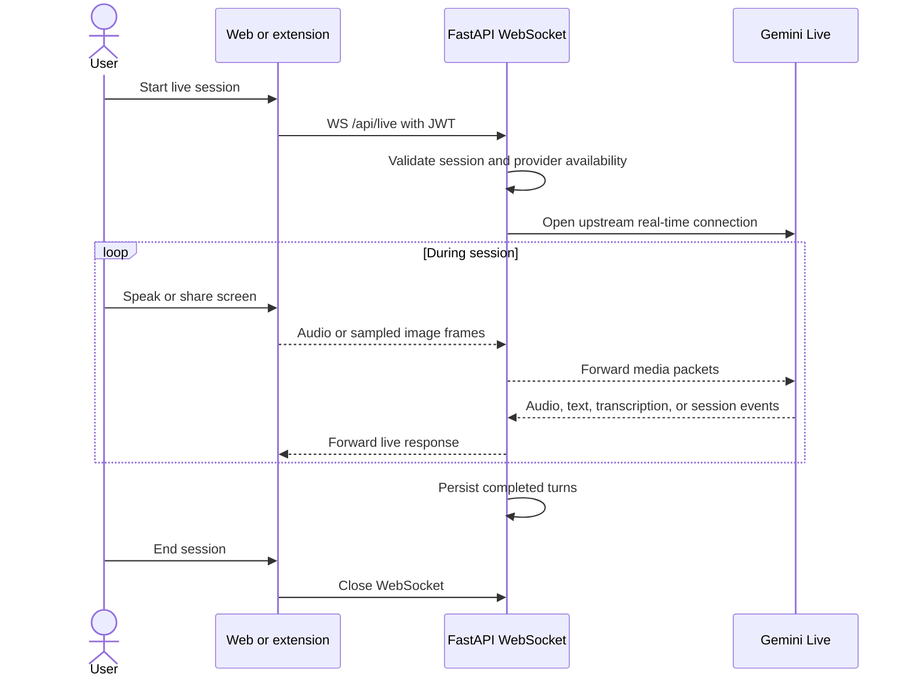
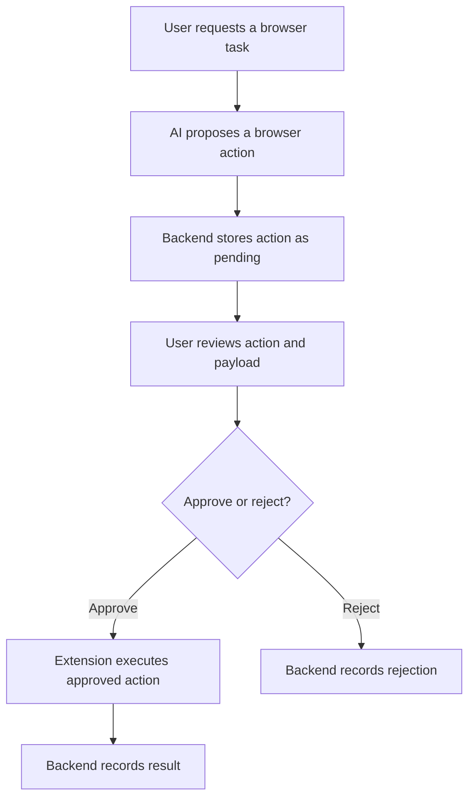

# OmniAssist

OmniAssist is a multimodal AI workspace with a React web interface and a Chrome Manifest V3 companion extension. It combines conversation, live voice and screen interaction, document retrieval, web search, persistent memories, usage tracking, and user-approved browser actions behind a FastAPI backend.

For the detailed project rationale, key capabilities, implementation design, database procedures, security model, provider integrations, and fault-tolerant routing behavior, see [Project Engineering Report](report.md).

## Features

- Chat with multiple AI providers through a provider-independent streaming API.
- Stream responses as NDJSON for responsive web interactions.
- Use Gemini Live for bidirectional voice and screen-aware conversations.
- Upload PDFs and text files for local retrieval-augmented generation (RAG).
- Search the web and attach results to responses.
- Persist conversations, messages, memories, proposed actions, and usage data.
- Use the Chrome side panel to inspect page content, explain selections, capture context, and suggest browser actions.
- Require explicit approval before proposed browser actions are executed.

## Architecture

OmniAssist consists of three main client-facing surfaces and one backend:



### Components

| Component | Responsibility |
|---|---|
| React web workspace | Main chat interface, conversations, file uploads, settings, memories, and usage views |
| Chrome side panel | Reads selected or visible page context and keeps OmniAssist alongside the current browser tab |
| Extension offscreen document | Supports browser tab capture and media processing for live interactions |
| FastAPI backend | Authentication, REST APIs, streaming responses, WebSockets, action control, and persistence |
| Provider gateway | Converts one application request into provider-specific API calls |
| RAG engine | Extracts uploaded documents, creates local hashed-vector chunks, and retrieves relevant context |
| SQLite | Stores users, chats, uploaded-file metadata, memories, actions, usage, and RAG vectors |
| External providers | Generate text, images, or live media responses |

## Data Flow

### Standard chat request



### Document upload and retrieval

```mermaid
flowchart LR
    Upload["User selects PDF or text file"]
    UploadAPI["POST /api/files"]
    Validate["Validate type, size, and content"]
    Extract["Extract text"]
    Chunk["Split text into overlapping chunks"]
    Vector["Create local Blake2s hashed vectors"]
    DB[(SQLite)]
    Query["Chat prompt"]
    Retrieve["Compare prompt vector with chunk vectors"]
    Context["Add relevant chunks to provider messages"]
    Answer["Generate grounded response"]

    Upload --> UploadAPI
    UploadAPI --> Validate
    Validate --> Extract
    Extract --> Chunk
    Chunk --> Vector
    Vector --> DB

    Query --> Retrieve
    DB --> Retrieve
    Retrieve --> Context
    Context --> Answer
```



Document text and hashed retrieval vectors stay in the backend-managed SQLite and upload storage. Only the selected prompt context and the text needed for the provider request leave the backend.

### Live voice and screen flow



### Browser action approval flow



The application is designed to keep proposed browser actions in a non-executing pending state until the user approves them.

## Repository Layout

```text
apps/
  web/        React web workspace
  extension/  Chrome side panel and background service
backend/
  app/        FastAPI application, authentication, RAG, and provider clients
  tests/      Backend API and provider tests
  data/       Default runtime database and upload location
```

## Prerequisites

- Python 3.10 or newer
- Node.js 18 or newer
- npm
- Google Chrome 116 or newer for the extension

At least one supported AI provider should be configured for model responses.

## Backend Setup

On Windows PowerShell:

```powershell
cd backend
python -m venv .venv
.venv\Scripts\Activate.ps1
python -m pip install --upgrade pip
pip install -r requirements.txt
Copy-Item .env.example .env
```

Edit `backend/.env` and set at least one provider key:

```dotenv
GEMINI_API_KEY=
OPENAI_API_KEY=
ANTHROPIC_API_KEY=
GROQ_API_KEY=
OPENROUTER_API_KEY=
NVIDIA_API_KEY=
TAVILY_API_KEY=
```

Set a persistent authentication secret:

```dotenv
OMNIASSIST_AUTH_SECRET=replace-with-a-long-random-secret
OMNIASSIST_WEB_ORIGIN=http://localhost:5173
```

Start the API:

```powershell
uvicorn app.main:app --reload --host 127.0.0.1 --port 8000
```

FastAPI documentation is available at:

- Swagger UI: `http://127.0.0.1:8000/docs`
- Health check: `http://127.0.0.1:8000/api/health`

## Web Application Setup

In a second terminal:

```powershell
cd apps\web
npm install
npm run dev
```

Open `http://localhost:5173`.

The Vite development server proxies `/api` requests to `http://127.0.0.1:8000`.

## Chrome Extension Setup

1. Open `chrome://extensions`.
2. Enable **Developer mode**.
3. Select **Load unpacked**.
4. Choose the `apps/extension` directory.
5. Pin OmniAssist Companion and open it from the Chrome side panel.

The extension expects the web application and backend to be running locally.

## Configuration

Backend configuration is read from `backend/.env`, the process environment, or the defaults in `backend/app/config.py`.

| Variable | Purpose | Default |
|---|---|---|
| `OMNIASSIST_DATABASE_PATH` | SQLite database location | `backend/data/omniassist.db` |
| `OMNIASSIST_UPLOAD_DIR` | Uploaded file storage location | `backend/data/uploads` |
| `OMNIASSIST_MAX_UPLOAD_BYTES` | Maximum upload size | `7340032` bytes |
| `OMNIASSIST_AUTH_SECRET` | JWT signing secret | Generated fallback |
| `OMNIASSIST_REGISTRATION_INVITE_CODE` | Optional registration invite code | Empty |
| `OMNIASSIST_DAILY_PROVIDER_REQUEST_LIMIT` | Daily provider request limit per user | `0` (disabled) |
| `OMNIASSIST_USAGE_RETENTION_DAYS` | Usage record retention period | `90` |
| `OMNIASSIST_LIVE_ENABLED` | Enable Gemini Live endpoints | `true` |
| `GEMINI_LIVE_MODEL` | Gemini Live model | `gemini-3.8-live` |
| `TAVILY_API_KEY` | Tavily web search credential | Empty |

Each provider also supports a configurable API key and model variable; see `backend/.env.example` for the complete list.

## API Overview

The backend exposes REST and WebSocket endpoints under `/api`.

| Area | Endpoints |
|---|---|
| Authentication | `POST /api/auth/register`, `POST /api/auth/login`, `GET /api/auth/me`, `DELETE /api/auth/account` |
| Conversations | `GET/POST /api/conversations`, `GET/PATCH/DELETE /api/conversations/{id}` |
| Chat | `POST /api/chat/stream` |
| Live media | `WS /api/live` |
| Models | `GET /api/models` |
| Files | `POST /api/files`, `DELETE /api/files/{id}` |
| Memories | `GET/POST/PATCH/DELETE /api/memories` |
| Actions | Propose, approve, reject, and record browser actions |
| Usage | `GET /api/usage` |
| Health | `GET /api/health` |

Most user data and action endpoints require an authenticated bearer token. Interactive route details and request schemas are available from FastAPI's Swagger UI.

## Data and Storage

OmniAssist uses SQLite and backend-managed filesystem storage. Runtime data includes:

- Registered users and authentication records
- Conversations and messages
- Uploaded file metadata and extracted text
- Document chunks and local RAG vectors
- User memories
- Proposed browser actions and results
- Model usage and cost-estimate records

Database and upload paths can be changed through environment variables. Do not store secrets or credentials in the database or in client-side source files.

## Testing

Run the backend tests from the repository root:

```powershell
cd backend
python -m pip install pytest pytest-asyncio
python -m pytest -q
```

Build the web application:

```powershell
cd apps\web
npm run build
```
