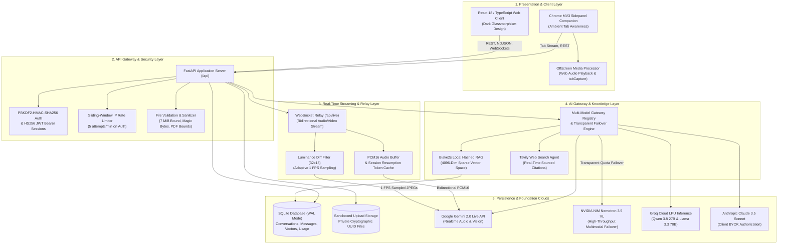
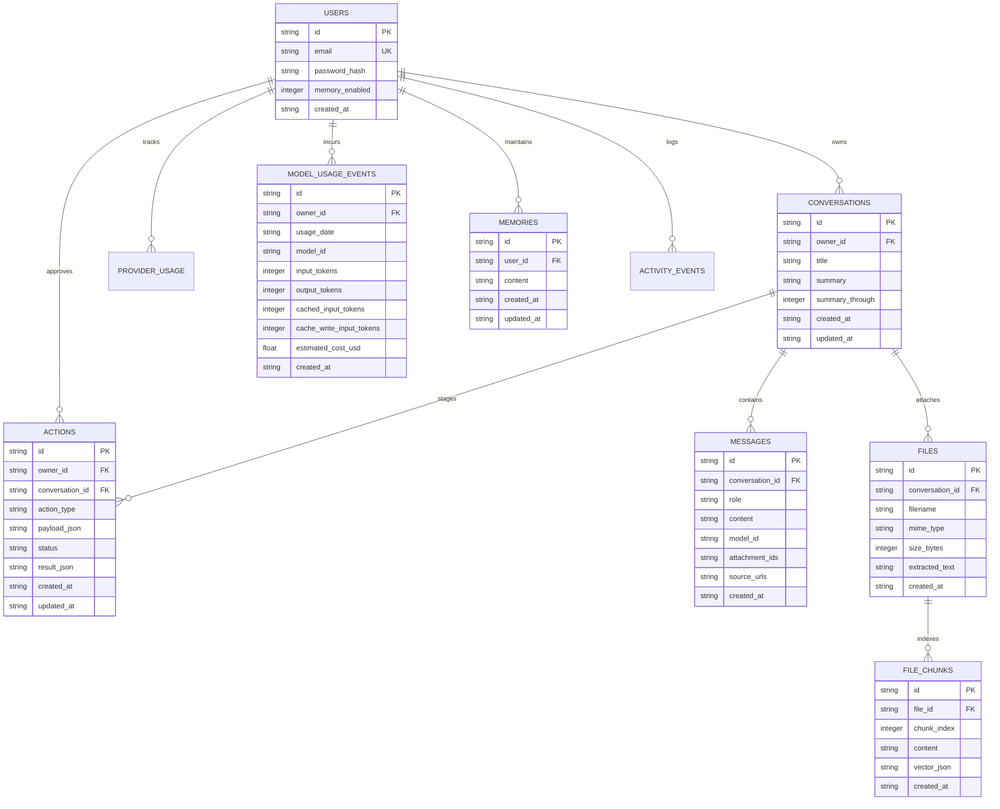

# OmniAssist: Complete Technical & Architectural Report

---

## 1. Executive Summary & System Philosophy

### 1.1 What is OmniAssist?
**OmniAssist** is an intelligent, privacy-preserving, multimodal interactive assistant featuring real-time visual screen perception, bidirectional continuous voice streaming, local-first document retrieval, and multi-model AI orchestration. Built with a dual-surface presentation layer—a responsive Glassmorphic Web Client and an ambient Google Chrome Manifest V3 Extension Sidepanel—OmniAssist allows users to collaborate with advanced foundation models without manual screenshot taking, window switching, or copy-pasting.

### 1.2 Why was it built?
Modern conversational AI interfaces (e.g., standard ChatGPT, Claude, or Gemini web apps) suffer from five critical architectural bottlenecks:
1. **Visual Disconnection:** They operate in isolated browser tabs disconnected from the user's active desktop environment. Users must manually capture, crop, save, and upload static screenshots.
2. **Turn-Based Conversational Latency:** Traditional request-response pipelines require users to wait for sequential text transcription, inference, and text-to-speech, preventing spontaneous conversational interruptions or natural back-and-forth dialogue.
3. **Fragile Provider Lock-In & Billing Cliffs:** Tying an application to a single AI provider causes complete operational failure when that provider experiences rate limits (HTTP 429), server downtime, or credit balance exhaustion ($0 balances).
4. **Data Sovereignty & Document Leakage:** Conventional Retrieval-Augmented Generation (RAG) frameworks send proprietary source code, internal research PDFs, and sensitive notes to third-party embedding models and cloud vector databases.
5. **Passive Dialogue vs Active Digital Automation:** Chatbots generate descriptive text but cannot interact directly with the user's active browsing session.

### 1.3 How does it work?
OmniAssist converges computer vision, audio stream processing, foundation model orchestration, and local document indexing into an integrated open architecture:
- **Continuous Screen Perception:** Captures display feeds via WebRTC (`getDisplayMedia` / `tabCapture`), processes frames through a 32x18 normalized luminance difference filter, and streams adaptive JPEG frames (capped at 1 FPS with a 15-second refresh) over WebSockets.
- **Sub-Second Voice Streaming:** Relays bidirectional 16-bit linear PCM audio to Google's Gemini Live API via an authenticated backend WebSocket relay, enabling natural conversational interruptions.
- **Resilient Multi-Model Orchestration:** Dispatches queries across Google Gemini, NVIDIA NIM (Nemotron 3.5 Super VL), Groq LPUs, and OpenRouter, supporting Bring-Your-Own-Key (BYOK) Anthropic Claude and transparent automatic failover when primary models hit quota limits.
- **Zero-Leakage Local RAG:** Extracts text from PDFs and source code, segments it into overlapping chunks, and indexes it into a 4096-dimensional sparse lexical vector space using Blake2s hashing stored directly in SQLite WAL mode.
- **Human-in-the-Loop Browser Automation:** Proposes structured browser actions (navigation, form filling, text copying) that require explicit user approval before execution by the Chrome Extension.

---

## 2. System Architecture & Component Interactions



---

## 3. Real-Time Media & Voice Pipeline

### 3.1 Adaptive Luminance Difference Screen Sampling
Streaming continuous video at standard 30 or 60 FPS to multimodal AI endpoints saturates uplink bandwidth (5–15 Mbps) and exhausts LLM context windows within minutes. To solve this, OmniAssist implements a client-side perceptual filter:

```
[Raw Screen Stream (60 FPS)] 
       │
       ▼
[Offscreen HTML5 Canvas Downscale (32 × 18 Grayscale)]
       │
       ▼
[Compute Normalized Luminance Matrix Delta: ΔL]
       │
       ├─ If ΔL > Threshold (Significant UI Change) ──► Encode JPEG ──► Send via WebSocket (1 FPS Cap)
       ├─ If Elapsed Time >= 15 seconds (Heartbeat)  ──► Encode JPEG ──► Send via WebSocket
       └─ If ΔL <= Threshold (Static Screen)         ──► Suppress Frame (Zero Bandwidth)
```

The mathematical delta calculation is defined as:
$$\Delta L = \frac{1}{32 \times 18} \sum_{x=1}^{32} \sum_{y=1}^{18} |L_t(x, y) - L_{t-1}(x, y)|$$
Where $L_t(x, y)$ represents the normalized pixel luminance in the range $[0.0, 1.0]$. 
- If $\Delta L$ exceeds the motion threshold, a JPEG frame resized to 1024px width is encoded and transmitted.
- Delivery to the AI provider is strictly throttled to at most **1 frame per second**.
- If the screen remains static, frames are suppressed, reducing idle video bandwidth to **0 Kbps**. A mandatory 15-second refresh frame ensures the model maintains current state.
- Transcribed user speech immediately forces a fresh visual observation.

### 3.2 Bidirectional Audio Streaming via Gemini Live
OmniAssist connects client microphones directly to Google's Gemini Live bidirectional WebSocket interface through the backend `/api/live` relay:
1. **Audio Capture:** The browser Web Audio API captures microphone input via an `AudioWorklet` or `ScriptProcessorNode`, downsampling audio to 16 kHz or 24 kHz 16-bit linear PCM.
2. **WebSocket Handshake:** The client connects to `ws://localhost:8000/api/live` and transmits an initial JSON authentication packet containing its HS256 JWT bearer token: `{"token": "<jwt_string>"}`.
3. **Bidirectional Relay:** The backend proxy validates the token, opens an upstream WebSocket to Gemini Live, and forwards interleaved audio packets and JPEG screen frames wrapped in `realtime_input` protocol messages.
4. **Session Resumption & GoAway Handling:** The relay listens for Gemini session resumption tokens. If Google's servers issue a `GoAway` or transient socket reset, the relay automatically reconnects using the cached session handle, preserving conversational history.
5. **Speech Synthesis:** Model responses are returned as streaming PCM audio chunks and played back in real-time through the Web Audio `AudioContext`.

---

## 4. Multi-Model AI Orchestration & Fault-Tolerant Routing

OmniAssist provides an abstracted, provider-agnostic model gateway (`backend/app/providers.py`). Foundation models are registered with standardized capability flags:

| Model ID | Provider | Capabilities | Vision Support | BYOK Required | Failover Priority |
| :--- | :--- | :--- | :---: | :---: | :---: |
| `gemini:gemini-flash-lite-latest` | Google Gemini | Text, Vision, Streaming, Documents | Yes | No | Primary Multimodal |
| `nvidia:nemotron-3.5-super-vl-120b` | NVIDIA NIM | Text, Vision, Streaming, Documents | Yes | No | Primary Failover |
| `openrouter:nemotron-3.5-super-vl:free` | OpenRouter | Text, Vision, Streaming, Free Tier | Yes | No | Free Multimodal |
| `groq:qwen/qwen3.8-27b` | Groq LPU | Text, Vision, Ultra-Low Latency | Yes | No | Fast Text/Vision |
| `groq:llama-3.3-70b-versatile` | Groq LPU | Text, Code, High-Speed Reasoning | No | No | Fast Text Reasoning |
| `openai:gpt-4o-mini` | OpenAI API | Text, Vision, Streaming | Yes | No | Standard Commercial |
| `anthropic:claude-haiku-4-5-20251001` | Anthropic Claude | Text, Vision, Native PDF Vision | Yes | Yes (BYOK) | Enterprise Vision |

### 4.1 Transparent Quota Failover Engine
A major resilience feature in OmniAssist is transparent automatic failover when commercial API keys encounter rate limits or credit balance exhaustion:
```python
# Interception and Fallback Logic in backend/app/providers.py
if model.provider == "OpenAI API":
    try:
        async for text in openai_compatible.stream(...):
            yield text
        return
    except RuntimeError as e:
        err_str = str(e).lower()
        if "credit balance exhausted" in err_str or "quota" in err_str or "429" in err_str:
            fallback = get_model("nvidia:nvidia/nemotron-3.5-super-vl-120b-a12b") or get_model("groq:qwen/qwen3.8-27b")
            if fallback and fallback.key:
                yield "*(OpenAI account has $0 balance. Automatically routed response via " + fallback.name + ")*\n\n"
                async for text in stream_completion(fallback, messages, on_usage):
                    yield text
                return
        raise
```
When a user with an unbilled OpenAI account submits a query, OmniAssist intercepts the HTTP 429 / credit exhaustion error, emits a clear markdown routing notification, and fulfills the multimodal query through NVIDIA's Nemotron 3.5 Super VL without dropping the user's turn.

### 4.2 Bring-Your-Own-Key (BYOK) Architecture
For high-end proprietary models such as Anthropic Claude 3.5, OmniAssist supports a client-managed BYOK model. Users input their Anthropic API key directly in the Settings modal. The key is stored in browser `localStorage` and passed to the backend strictly via the `X-Anthropic-Api-Key` request header during chat requests. The key is never persisted in the SQLite database, ensuring complete credential ownership.

---

## 5. Local-First Document Processing & Hashed-Vector RAG Engine

Rather than relying on external vector databases (Pinecone, ChromaDB, Weaviate) or hosted embedding models (OpenAI `text-embedding-3`), OmniAssist implements a mathematical, dependency-free local RAG engine (`backend/app/rag.py`).

### 5.1 Document Ingestion & Chunking
- **Supported Formats:** PDF (`.pdf`), plain text (`.txt`, `.md`), and source code (`.py`, `.ts`, `.tsx`, `.js`, `.json`, `.sql`, `.html`, `.css`, etc.).
- **PDF Extraction:** Handled via `pypdf`, validating binary headers (`%PDF-`), enforcing a 100-page limit, and stripping encrypted payloads. Text extraction is capped at 80,000 characters per document.
- **Chunking Strategy:** Extracted text is segmented into fixed-size windows of **1100 characters** with an overlap of **150 characters** to preserve semantic continuity across boundaries:
  $$\text{Window}_i = \text{Text}[i \times (1100 - 150) : i \times (1100 - 150) + 1100]$$

### 5.2 Blake2s 4096-Dimensional Hashed Lexical Vectors
Each text chunk is projected into a 4096-dimensional sparse vector space using cryptographic Blake2s hashing:
```python
def _vector(text: str) -> dict[str, float]:
    counts: dict[str, float] = {}
    for term in re.findall(r"[a-zA-Z0-9_]{2,}", text.lower()):
        # Map term deterministically into a bucket between 0 and 4095
        key = str(int.from_bytes(hashlib.blake2s(term.encode(), digest_size=2).digest(), "big") % 4096)
        counts[key] = counts.get(key, 0.0) + 1.0
    # Compute L2 Euclidean norm
    norm = math.sqrt(sum(v * v for v in counts.values())) or 1.0
    return {k: v / norm for k, v in counts.items()}
```
1. **Hashing Trick:** Token n-grams are hashed via Blake2s with a 2-byte digest size and modulo-reduced to 4096 discrete feature buckets.
2. **Frequency Weighting & Normalization:** Term frequencies within each bucket are accumulated and normalized by the Euclidean $L_2$ norm, creating a unit-length sparse vector.
3. **Storage:** Vectors are stored as compact JSON dictionaries in the SQLite `file_chunks` table alongside the chunk index and text content.

### 5.3 Local Cosine Similarity Retrieval
When a user submits a query:
1. The query text is vectorized into the identical 4096-bucket sparse space: $\mathbf{q}_{\text{norm}}$.
2. Stored chunk vectors $\mathbf{d}_i$ for that conversation are loaded from SQLite.
3. Cosine similarity is computed via dot product:
   $$\text{Score}(\mathbf{q}, \mathbf{d}_i) = \sum_{k \in \mathbf{q} \cap \mathbf{d}_i} q_k \cdot d_{i, k}$$
4. Chunks scoring above a baseline threshold of $0.025$ are sorted in descending order, and the top 5 excerpts are injected into the model's system context prompt.

---

## 6. Database Architecture & Transaction Procedures

OmniAssist utilizes **SQLite 3** operating in **Write-Ahead Logging (WAL)** mode with strict foreign key constraints (`PRAGMA foreign_keys = ON`).

### 6.1 Database Schema Diagram


### 6.2 Transactional Integrity & Context Management
All state mutations execute within the `transaction()` context manager in `backend/app/db.py`:
```python
@contextmanager
def transaction():
    conn = connect()
    try:
        yield conn
        conn.commit()
    except Exception:
        conn.rollback()
        raise
    finally:
        conn.close()
```
- **Atomicity:** Any exception occurring during multi-row updates (e.g., adding a message while updating conversation timestamps and token ledgers) immediately triggers a full rollback.
- **Cascade Deletions:** Deleting a user or conversation automatically purges child messages, attached files, RAG chunks, and pending actions via `ON DELETE CASCADE`.
- **Sliding-Window IP Rate Limiting:** The `auth_rate_limits` table tracks failed login timestamps per IP address. An atomic query evaluates attempts within the last 60 seconds; exceeding 5 attempts immediately rejects the request.

---

## 7. Security Architecture & Defense-in-Depth

| Security Domain | Implementation Standard | Threat Mitigated |
| :--- | :--- | :--- |
| **Password Hashing** | PBKDF2-HMAC-SHA256, 310,000 iterations, 16-byte random salt | Brute-force attacks, GPU rainbow table lookups |
| **Session Security** | HS256 JWT bearer tokens (12-hour expiry) signed with random secret | Session hijacking, replay attacks |
| **Timing Attack Resistance** | `hmac.compare_digest` for password & token verification, dummy hash verification on invalid user | Side-channel timing discrepancies |
| **File Upload Defense** | Extension allowlist, magic byte verification (`%PDF-`, PNG/JPEG signatures), 7 MiB size limit, 100-page PDF limit | Malicious executable execution, buffer overflow, ZIP/PDF bombs |
| **Path Traversal Protection** | `safe_filename()` strips `..`, `/`, `\`, and non-printable control characters | Directory traversal attacks (`../../etc/passwd`) |
| **CORS Regulation** | Strict origin regex: local dev ports, private subnets, and `chrome-extension://[a-p]{32}` | Cross-Site Request Forgery (CSRF), malicious web callers |
| **Browser Action Safety** | Strict allowlist: `navigate`, `search`, `copy_text`, `scroll`, `fill_field`; mandatory user approval | Prompt injection attacks leading to unauthorized actions |

---

## 8. Justification of Tech Stack Choices

### 8.1 Why FastAPI & Python for the Backend?
- **Native Asynchronous Streaming:** FastAPI's asynchronous core (built on Starlette and AnyIO) allows streaming NDJSON token deltas and managing long-lived WebSocket connections without blocking worker threads.
- **Rich Scientific & Document Ecosystem:** Native access to `pypdf`, `Pillow (PIL)`, and `hashlib` enables high-speed, in-memory document parsing and cryptographic hashing without external subprocesses.
- **Type Safety with Pydantic:** Request validation, model capability serialization, and settings parsing are strictly validated at the API boundary.

### 8.2 Why React 18, TypeScript & Tailwind CSS for the Frontend?
- **Concurrent React 18 Rendering:** Ensures smooth typing animations, non-blocking markdown streaming updates, and seamless UI transitions during heavy streaming loads.
- **Glassmorphic Design Tokens:** Tailwind CSS allows composable backdrop filters, ambient gradients, and responsive layouts that match modern design aesthetics without performance overhead.
- **End-to-End Type Safety:** TypeScript ensures consistent data contracts between FastAPI JSON schemas and frontend state management.

### 8.3 Why SQLite with WAL Mode over PostgreSQL?
- **Local-First Zero-Maintenance:** OmniAssist is designed as a local-first workspace. SQLite eliminates external database server setup, connection pooling overhead, and port conflicts.
- **Write-Ahead Logging (WAL):** WAL mode allows concurrent readers to access database records while write operations execute, eliminating locking contention.
- **Zero Latency:** In-process database calls execute in microseconds, providing near-instantaneous conversation lookups and RAG vector searches.

### 8.4 Why Blake2s Hashed Vectors over Hosted Dense Embeddings?
- **Zero Data Leakage:** Stored text never leaves the user's local machine for embedding generation.
- **Zero API Dependency & Cost:** Eliminates recurring embedding API costs and network roundtrip latency.
- **Superior Lexical & Code Precision:** Sparse hashed vectors preserve exact code keywords, variable names, and technical terms that are frequently lost in dense semantic vector embeddings.

### 8.5 Why Chrome Manifest V3 Sidepanel over Electron?
- **Zero Memory Overhead:** A Chrome Extension operates directly within the user's existing browser instance, avoiding the 300+ MB RAM footprint of bundling a separate Chromium/Electron runtime.
- **Native Context Awareness:** Directly accesses active browser tabs, DOM selections, and `tabCapture` streams through official Chrome APIs.

---

## 9. Conclusion
The OmniAssist architecture establishes a production-grade, highly resilient multimodal assistance platform. By uniting adaptive visual perception, sub-second audio streaming, multi-model failover orchestration, and privacy-preserving local RAG, OmniAssist delivers an uncompromised, future-ready AI workspace.
