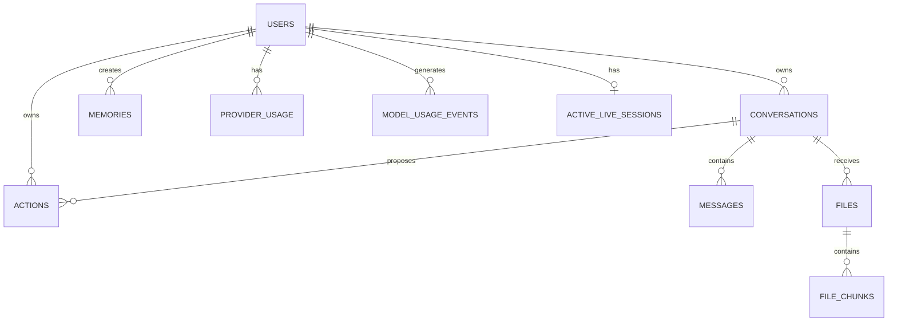
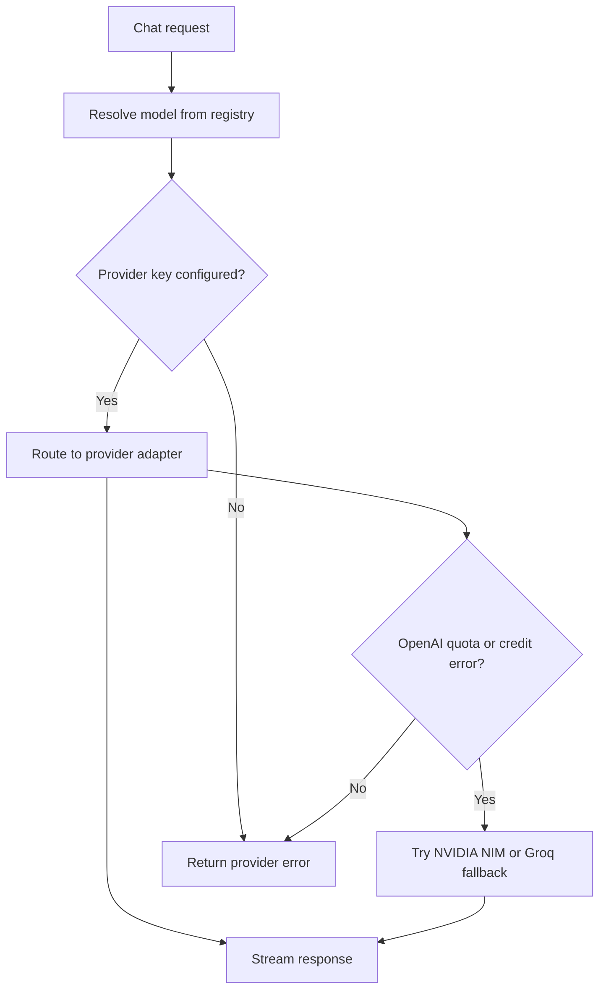

# OmniAssist Engineering Report

## Executive Summary

OmniAssist is a multimodal AI workspace that brings chat, live voice, screen context, document retrieval, web search, persistent memory, usage accounting, and browser assistance into one application. It uses a React web client and a Chrome Manifest V3 side-panel companion with a Python FastAPI backend.

The system is designed around provider independence, local-first data storage, streaming responses, and explicit user approval for browser actions.

## Why OmniAssist Was Built

Standalone chat applications often separate users from the information on their screen or in their browser. OmniAssist addresses that disconnect by allowing users to:

- Ask questions while sharing visual or page context without manually repeating it.
- Continue conversations naturally through voice and text.
- Search private documents without maintaining a separate cloud vector database.
- Switch or fall back between AI providers instead of depending on one vendor.
- Receive proposed browser actions while retaining control over execution.
- Keep conversation, memory, document, and usage state in an application-managed backend.

The project also separates presentation, provider orchestration, local persistence, retrieval, and browser integration so each concern can evolve independently.

## Key Capabilities and Features

### Conversational AI

- Supports provider-selected text conversations.
- Streams partial model output as NDJSON.
- Persists conversation titles, summaries, messages, and attachments.
- Loads conversation memory and recent context for follow-up questions.
- Supports conversation deletion and account removal.

### Live Voice and Visual Interaction

- Provides a WebSocket endpoint for live Gemini sessions.
- Relays bidirectional audio and sampled visual frames.
- Uses provider transcription and session events.
- Saves completed live turns back to the active conversation.
- Supports session resumption and live-session lease refresh.

### Document Retrieval-Augmented Generation

- Accepts PDF and text-based uploads.
- Validates file type and maximum upload size.
- Extracts text and splits it into overlapping chunks.
- Generates local hashed vectors using BLAKE2s.
- Searches document chunks for context relevant to a query.
- Stores extracted text and vectors in the application database.

### Web and Browser Assistance

- Supports sourced web search through Tavily when configured.
- Reads page context from the Chrome side panel.
- Allows the user to explain selected text or visible page content.
- Supports page, search, scroll, copy, and form-related action proposals.
- Stores proposed actions as pending until the user approves or rejects them.

### Persistent Memory and Usage

- Stores optional user memories.
- Can inject enabled memories into model context.
- Tracks provider request counts per UTC day.
- Records model input, output, cached input, cache-write tokens, and optional cost estimates.
- Applies configurable usage retention to remove old records.

## How It Works

### Conversation Flow

1. The React client or Chrome companion sends an authenticated request.
2. FastAPI validates the bearer JWT and loads the user.
3. The backend loads the target conversation, enabled memories, and relevant RAG chunks.
4. The selected model is resolved from the provider registry.
5. The provider adapter converts the OmniAssist message format into a provider request.
6. Partial output is streamed to the client.
7. The final response and usage details are persisted.

### Local RAG Flow

1. A file is uploaded to `POST /api/files`.
2. The backend validates MIME, extension, size, and document structure.
3. Text is extracted with PyPDF or direct text decoding.
4. Text is divided into chunks of approximately 1,100 characters with 150-character overlap.
5. Each chunk is hashed into normalized 4,096-bucket sparse vectors.
6. A query receives the same hashing treatment.
7. Chunk vectors are scored with cosine-style dot products and the highest relevant chunks are injected into the prompt.

The RAG implementation has no external embedding API dependency, keeping document text and vectors local to the backend.

### Browser Action Flow

1. The AI proposes an allowlisted action.
2. FastAPI stores the action with `pending` status.
3. The user reviews the action and payload.
4. The backend changes the status to approved or rejected.
5. Only an approved action is sent to the Chrome extension for execution.
6. The extension result is persisted and associated with the action.

## Technology Stack and Justifications

| Component | Technology | Why it is used |
|---|---|---|
| Backend API | Python 3.10+ and FastAPI | Asynchronous REST, WebSocket, and streaming support with small, type-focused route definitions |
| Configuration | Pydantic Settings | Typed environment configuration with defaults and `.env` support |
| Persistence | SQLite | Local-first, dependency-light storage with transactions and foreign-key support |
| Web client | React, TypeScript, Vite | Component-based interface with static typing and fast development builds |
| Browser extension | Chrome Manifest V3 | Native side-panel, tab, content, and media integration |
| Document processing | PyPDF and Pillow | PDF text extraction and image/PDF handling without a separate document service |
| RAG | BLAKE2s hashed vectors | Private local retrieval without cloud embedding APIs or external vector infrastructure |
| Real-time media | WebSockets | Bidirectional streaming for live voice and visual packets |
| Chat streaming | NDJSON | Incremental provider output without waiting for a complete response |
| Security | PBKDF2-HMAC-SHA256 and HS256 JWT | Password hashing and stateless authenticated API sessions |

The stack is intentionally suitable for a local or small hosted deployment. SQLite and local file storage avoid infrastructure overhead while keeping the provider interface replaceable.

## Database Schema

The database is initialized in `backend/app/db.py`. Foreign keys are enabled for transactions, and the schema includes indexes for common conversation, usage, file, and action queries.

### Core Tables

| Table | Purpose |
|---|---|
| `users` | User identity, password hash, memory preference, and creation time |
| `auth_rate_limits` | Sliding-window authentication attempt accounting |
| `provider_usage` | Daily provider request counts per user |
| `model_usage_events` | Model-level token and estimated-cost events |
| `active_live_sessions` | Current live-session identity and lease time |
| `conversations` | Owned conversation metadata, title, summary, and timestamps |
| `messages` | Conversation turns, roles, models, attachments, and source URLs |
| `files` | Uploaded file metadata and extracted text |
| `file_chunks` | Chunk text and JSON-serialized hashed vectors |
| `memories` | User-authored persistent facts |
| `activity_events` | Application activity associated with users and conversations |
| `actions` | Proposed browser actions, status, payload, and result |

### Relationships

Account deletion cascades or explicitly removes owned conversations, memories, usage records, activity, live sessions, and the user. Uploaded files associated with deleted conversations are removed from backend-managed storage.

## Database Procedures

- SQLite connections enable `PRAGMA foreign_keys = ON`.
- Schema creation uses `CREATE TABLE IF NOT EXISTS` and `CREATE INDEX IF NOT EXISTS`.
- Existing installations are upgraded with targeted column checks and additions.
- Runtime reads and writes use transactions that commit on success and roll back on exceptions.
- Conversation and message queries are ordered by timestamps.
- Usage records are grouped by UTC date.
- Old provider usage and model usage records are deleted according to `OMNIASSIST_USAGE_RETENTION_DAYS`.
- The legacy account mechanism supports existing local conversations before normal registration migration.

## Security Model

### Authentication

- Passwords use PBKDF2-HMAC-SHA256 with 310,000 iterations and a random salt.
- Password verification uses constant-time comparisons.
- JWTs use an HS256 signature and expire after 12 hours.
- A persistent `OMNIASSIST_AUTH_SECRET` should be configured for production.
- Authentication endpoints apply an IP-based minute-window rate limit.
- Account deletion requires the current password.

### File Safety

- Upload size is limited by `OMNIASSIST_MAX_UPLOAD_BYTES`.
- File names are sanitized.
- Upload handling validates supported types and sizes.
- PDF processing has bounded page and size handling.
- Extracted content remains in backend storage and SQLite.

### API and Browser Safety

- CORS and extension origin access are bounded by backend configuration.
- Protected routes require a valid bearer token.
- Browser actions use an allowlisted type set and remain pending until user approval.
- Proposed action payloads are stored before execution, allowing review and rejection.
- User and provider secrets should remain in environment variables and never in source or browser storage.

### Operational Security

- Use HTTPS and a persistent secret for any non-local deployment.
- Restrict database and upload-directory permissions.
- Keep `.env`, database files, uploaded data, and credentials out of source control.
- Review third-party provider data policies before sending sensitive documents or prompts.

## AI Model Connections

OmniAssist uses a provider registry with a consistent application model identifier:

- Google Gemini
- OpenAI API
- Anthropic Claude
- Groq
- OpenRouter
- NVIDIA NIM
- Google Gemini Live
- Tavily web search

Provider credentials and model identifiers are read from backend settings. `/api/models` reports whether each model is configured and exposes capabilities such as text, streaming, image, document, BYOK, and provider metadata.

Anthropic Claude models use bring-your-own-key behavior for the configured client key path. A provider is not usable until its required key is available.

## Fault-Tolerant Routing

The provider gateway keeps provider-specific behavior behind `stream_completion()`.

### OpenAI fallback behavior

The implementation detects credit-balance, quota, and HTTP 429-style errors from the OpenAI adapter. If the NVIDIA NIM fallback or another configured fallback is available, it streams a short routing notice followed by the fallback response.

The fallback order currently checks:

1. NVIDIA Nemotron 3.5 Super VL
2. Groq Qwen
3. A configured Gemini model

### Live-session fault tolerance

Gemini Live sessions maintain a resumable session handle and reconnect attempts. The backend tracks active-session leases, refreshes them during activity, and persists completed transcribed turns.
